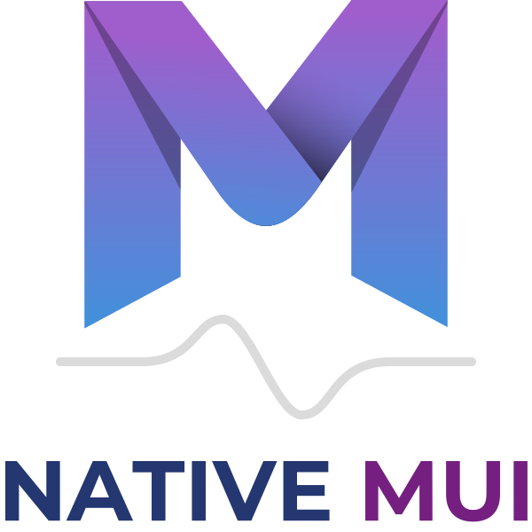

# nmui — native Material UI



Material 3 Expressive, in vanilla JS/HTML/CSS. No framework. No build step.
No dependencies. Spec: https://m3.material.io/

## Use the library

This repo holds two things: **the library** — `components/`, `css/`, and
`layout/` — and **this documentation site** (`app/`, `app.js`, `index.html`),
which is built with the library but isn't part of it. To use nmui in your
own project you only need the library folders:

```sh
git clone https://github.com/nativemui/nmui.git
# copy components/ and css/ into your project (layout/ too, for Panes)
```

Importing a component registers it; that's the whole setup. Then the tag
just works, in any HTML page:

```html
<script type="module">
  import "./components/button/button.js";
</script>

<nmui-button tonal>Save draft</nmui-button>
```

Or take everything at once with the barrel: `import "./components/index.js"`.
Variants are bare attributes (`tonal`, `outlined`, `xxlarge`, `rounded`) —
never classes or config objects. Components read the standard M3 color
roles (`--md-sys-color-*`) and ship with baseline fallbacks, so they look
right with no theme at all; for the full light/dark themes, link
`css/themes.css` and set `<html theme="dark">`. The docs site has a
**Getting started** guide (`/docs/getting-started`) with the same walkthrough,
plus a theming tool that exports theme files.

## Run the docs site

**Docker, live (no rebuilds):**

```sh
docker compose up    # serves THIS folder via a bind mount —
                     # edit files, refresh, done
```

Then open http://localhost:8080. The demo app is built with the library itself.
Rebuild (`docker compose up --build`) only when the Dockerfile or
nginx.conf changes. Without compose, the equivalent one-liner is
`docker run --rm -p 8080:80 -v "$PWD":/usr/share/nginx/html:ro nmui-site`
after one `docker build -t nmui-site .`.

Or serve the folder with the included dev server (SPA fallback built in):

    python3 serve.py            # http://localhost:8080

Anything static also works (`npx serve .`, `python3 -m http.server`, …) but
plain static servers 404 on refresh for deep links — that's the server, not
the app. Docker/nginx handles it via `try_files`; hosts like GitHub Pages
serve the included `404.html` (a copy of `index.html`, so the router still
boots).

## Layout

```
index.html                  # 9 lines: <App> mount + app.css link + app.js
404.html                    # copy of index.html — SPA fallback for static hosts
app.js                      # boots <App>: theme API + tiny router, renders pages
examples/router/            # standalone router.js + SPA fallback config per stack
Dockerfile / nginx.conf     # nginx serves index.html for all routes (SPA fallback)
assets/
  logo.svg                  # full brand lockup (mark + NATIVE MUI wordmark)
  mark.svg                  # gradient mark (nav, favicon, hero)
css/
  app.css                   # THE stylesheet: @imports everything below
  base.css                  # mount + page defaults + demo nav
  tokens.css                # shape, elevation, easing (theme-independent)
  typography.css            # M3 typescale: full token anatomy + type elements
                            # <display> <headline> <nmui-title> <nmui-body> <label>
  motion.css                # M3 Expressive spring curves (linear() approximations)
  layout.css                # M3 panes: three axes, derived layouts, feed
  themes.css                # theme aggregator — add a theme with one @import
  themes/
    light.css               # default light roles
    dark.css                # default dark roles
layout/
  panes.js                  # drag-handle resizing for Panes[resizable]
                            # (import once; enhances light DOM, no elements)
components/
  index.js                  # barrel — import to get every component
  button/                   # …one folder per family: app-bar, badge, card,
    button.js               # self-registering custom element (29 families)
    button.css              # constructable stylesheet, `with { type: "css" }`
app/
  pages/
    index.js                # route table: path -> lazy page module
    nav.js                  # shared page nav
    demo.js                 # output+code demo helper (single source of truth)
    home.js / home.css      # landing (/)
    docs.js / docs.css      # docs (/docs)
    docs/
      button.js             # button docs (/docs/button)
      layout.js / layout.css # layout docs (/docs/layout)
      …                     # one docs page per component (/docs/card, …)
```

`index.html` needs exactly one stylesheet because `app.css` pulls the rest
with `@import`. The imports are render-blocking, so the theme is present at
first paint (no dark-mode flash); the tradeoff is the browser discovers them
serially instead of in parallel. Anyone who cares can swap back to separate
`<link>`s.

## Panes

`<Pane>` describes behavior, not content — three independent axes, one
attribute each (a bare `<Pane>` is flexible, persistent, co-planar):

```html
<Panes resizable id="inbox">
  <Pane fixed>…</Pane>
  <Pane flexible>…</Pane>
</Panes>
```

- sizing: `fixed` | `flexible` (default flexible; layouts need ≥1 flexible)
- lifetime: `temporary` | `persistent` (default persistent — widths survive
  reloads and breakpoint changes via localStorage, keyed by the Panes `id`)
- display (non-primary panes): coplanar (default) | `floating` | `docked`
- adapt (non-primary panes): `showhide` (default) | `levitate="floating|docked"`
  | `reflow`
- breakpoint display overrides, mobile-first: `docked medium="floating"
  large="coplanar"` (base is compact — no `compact=`)

The layout is derived from the panes — two flexible panes are a split-pane
(spacer centered), a `fixed` pane makes it fixed-and-flexible. `feed` is the
only layout attribute (card grid). 1–3 panes, in order, first is primary.
Floating/docked are overlays, never grid items. See `/docs/layout`.

## Routing

No library. The route table maps paths to dynamic imports (code splitting
with no build step). In-app links are `<a data-link href="/docs">`,
intercepted into `history.pushState`; back/forward come through `popstate`;
the URL is the source of truth on load. Every page exports
`{ title, render(mount, nmui) }` and the router sets `document.title`.

The router is documented as an optional extra (it is not part of M3):
see the **Router** page in the demo app (`/docs/router`) for the full
guide — route parameters, guards, the hash-router variant — plus the
server half: an SPA needs its server to fall back to `index.html` for
unknown paths, and the guide shows that config for nginx, Apache,
Caddy, IIS, Netlify, Vercel, Cloudflare Pages, Firebase, GitHub Pages,
Node, Python (including an INI-driven server), PHP, Go, Rust, Rails,
ASP.NET Core, Spring Boot, and Docker. On the page, each stack has
its own small card in a grid — brand logo and name, all at one
level — and each card opens that stack's config in a dialog (M3's
modal surface). The logo files live in `assets/logos/`.
Copy-paste files for each stack
live in `examples/router/`, including the standalone `router.js`.

## The pattern (every component)

```js
import buttonStyles from "./button.css" with { type: "css" };

document.adoptedStyleSheets.push(buttonStyles);

class NMUIButton extends HTMLElement { /* … */ }

if (!customElements.get("nmui-button")) {
  customElements.define("nmui-button", NMUIButton);
}

export { NMUIButton };
```

- One tag per family; bare attributes declare role + variants.
- Light DOM, no shadow root — themes cascade straight in.
- No guard rails for bad markup — the browser is the debugger.
- Every finished component's docs page has an **Events** section: the
  events you can listen for (custom `change` payloads in `event.detail`,
  plus the relevant native events), what to attach them to, and the
  native programmatic patterns that work in code — property sets like
  `input.checked = true` or `btn.selected = true` update state and
  visuals but fire no event (native behavior); `.click()` performs the
  full action, events included.

## Theming

One attribute: `<html theme="dark">`. Add a theme: copy
`css/themes/light.css`, change the values, `@import` it in `css/themes.css`.

The theme is applied before first paint (inline head script), so dark mode
never flashes white. Persisted in `localStorage`; `nmui.theme("dark")` in JS.

The docs app has a **theming tool** (`/docs/theming`): edit every color
role and the corner scale against a live preview of real components,
start from a preset (NMUI Light, NMUI Dark, Industrial Dark, High
Contrast), and export the theme as a standalone `theme-<name>.css`, or
load one back in. It checks WCAG contrast ratios live and guards the
error color: red is semantic (alarm), so a theme whose error drifts
out of the red family gets a loud warning on the page and in the
exported file's header. Color math is hand-rolled — no color library.

## Notes

- CSS module scripts (`with { type: "css" }`) need Chrome/Edge 93+ or
  Firefox 147+. Safari doesn't support them — Safari is left behind, per
  project policy.
- Components use `var(--md-sys-*, <m3 baseline>)` fallbacks, so a single
  component works standalone with zero theme setup.

## Versions

Source of truth is this repo — new builds land as commits on `main`.
(The project was previously delivered as versioned zips,
`nmui.0.1.0.zip`, `nmui.0.2.0.zip`, …; the current version is in
`nmui.version` at runtime.)

## License

MIT — see `LICENSE`.
